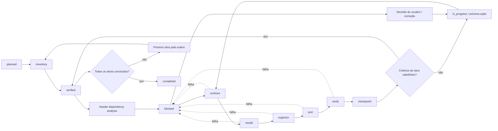

# ctrust

Conjunto de **skills, agentes e scripts** para converter código legado C em Rust, priorizando modelagem idiomática, preservação de comportamento, redução de `unsafe` e migração verificável. FFI é suportada apenas como estratégia opcional de coexistência temporária entre os dois ecossistemas.

O ctrust não tenta traduzir C mecanicamente. Ele organiza a conversão em etapas pequenas: inventariar o legado, entender contratos e invariantes, modelar tipos e ownership em Rust, implementar código idiomático e verificar o comportamento contra a versão original. Quando a conversão for incremental, uma fronteira de migração — eventualmente baseada em FFI — pode manter os componentes C e Rust em coexistência temporária.

## Objetivos

- mapear módulos, símbolos, dependências, macros, tipos e pontos de entrada de um código C;
- reduzir riscos de `unsafe`, ownership, lifetime, concorrência, aritmética de ponteiros e gerenciamento manual de memória;
- preservar contratos observáveis durante a conversão;
- transformar estruturas, erros e APIs C em abstrações idiomáticas e seguras em Rust;
- orientar a substituição gradual de componentes C por módulos Rust;
- oferecer suporte opcional a fronteiras temporárias de migração, inclusive FFI quando necessário;
- gerar evidências de compilação, testes, análise estática e comparação de comportamento.

## Estrutura

```text
ctrust/
├── agents/
│   ├── ctrust-lead.md
│   ├── c-analysis-specialist.md
│   └── ctrust-rust-safety-auditor.md
├── skills/
│   ├── c-code-inventory/SKILL.md
│   ├── data-structure-mapping/SKILL.md
│   ├── c-behavior-extraction/SKILL.md
│   ├── c-to-rust-migration/SKILL.md
│   ├── context-recovery/SKILL.md
│   ├── contract-extraction/SKILL.md
│   ├── migration-boundary-design/SKILL.md
│   ├── migration-scoping/SKILL.md
│   ├── migration-verification/SKILL.md
│   ├── rust-domain-modeling/SKILL.md
│   └── rust-module-organization/SKILL.md
├── tools/
│   ├── artifact_sync/
│   ├── function_recovery.py
│   ├── header_dependency_analyzer/
│   │   ├── analyze.py
│   │   ├── export_inventory.py
│   │   └── README.md
│   └── organization/
│       ├── core.py
│       ├── naming.py
│       ├── models.py
│       ├── serializers.py
│       └── cli.py
├── templates/
│   ├── behavior.yaml
│   ├── Cargo.workspace.toml
│   ├── contract.yaml
│   ├── data-structures.yaml
│   ├── checkpoint-function.md
│   ├── codec-validation.yaml
│   ├── dependency-policy.yaml
│   ├── dto.yaml
│   ├── function-map.yaml
│   ├── function-unit.yaml
│   ├── mapping-confirmation.yaml
│   ├── message-errors.yaml
│   ├── test-evidence.ndjson
│   ├── zenoh-transport.yaml
│   ├── slice-plan.md
│   ├── slices.yaml
│   └── unit-plan.md
├── scripts/
│   ├── api-safety-gate.sh
│   ├── data-structure-gate.sh
│   ├── dependency-architecture-gate.sh
│   ├── function-recovery-gate.sh
│   ├── migration-comparison.sh
│   ├── organization-gate.sh
│   ├── behavior-gate.sh         # exige behavior.yaml confirmado
│   ├── call-graph-cscope.sh        # análise de chamadas e símbolos C via cscope
│   ├── check-ffi-surface.sh   # auditoria opcional de fronteiras/unsafe
│   ├── ctrust-state.sh        # estado, resume e checkpoints
│   ├── migration-completeness.sh # bloqueia stubs e exige origem C rastreável
│   ├── migration-gate.sh
├── sync.sh
└── README.md
```

## Instalação e sincronização

O instalador `sync.sh` distribui os agentes, skills e scripts do ctrust para os diretórios convencionais dos clientes de IA. A instalação é não destrutiva: arquivos existentes com conteúdo diferente são preservados e reportados como conflitos.

### Pré-requisitos e protocolo de execução

Use Python 3.10+ e instale as dependências do controlador antes de executar o workflow:

```bash
python3 -m pip install -r tools/requirements.txt
# Necessário para o inventário C:
python3 -m pip install -r tools/header_dependency_analyzer/requirements.txt
```

Depois da instalação no destino, os mesmos arquivos ficam em `.ctrust/tools/`.
O controlador usa PyYAML para ler os artefatos estruturados e rejeita chaves YAML duplicadas.

O protocolo operacional é:

1. Inicialize o destino e defina o escopo/manifesto antes do inventário.
2. Execute `reconcile` para selecionar o slice elegível e derivar a próxima fase; dependências bloqueantes precedem callers. Ciclos, IDs duplicados, dependências desconhecidas e múltiplos slices ativos bloqueiam a seleção.
3. Confirme estruturas, mapping, comportamento, contrato e o modelo (`status: confirmed`) antes do port. A presença de um template não conclui uma fase.
4. Execute `organize` e `validate-organization`. O plano respeita o crate e o produto do slice; cada slice mantém `<slice-id>-organization.yaml`, e `organization.yaml` mostra o plano mais recente.
5. Use `function-map` para atualizar mapas legados v1 para v2 preservando o conteúdo. `select-function` atribui IDs únicos e retoma implementação, testes ou comparação conforme o estado salvo.
6. Registre implementação e evidência NDJSON para a unidade ativa. A evidência deve identificar `slice_id`, `unit_id`, `function_id`, comando, origem do expected result, valores `expected`/`observed` iguais e `result: passed`. Comparação exige categorias `normal`, `boundary` e `error`; sem referência legada, exige também `unresolved_reference`, motivo explícito e expectativas independentes.
7. Execute `compare ... passed` para verificar a função e atualizar `comparison.yaml`. Este comando não declara o slice verificado.
8. Execute `.ctrust/sync.sh verify-slice . <slice-id>` para validar artefatos, origem, organização, completude e Cargo, marcar o slice verificado, criar checkpoint e selecionar o próximo slice. Preencha o checkpoint com as decisões e limitações da revisão.

Os gates usam o slice ativo por padrão. Um segundo argumento seleciona um slice; `--all` exige artefatos de todos os slices para a revisão final:

```bash
.ctrust/scripts/migration-gate.sh . parser-001
.ctrust/scripts/migration-gate.sh . --all
```

`reconcile` preserva bloqueios, erros e tentativas. Depois de corrigir a causa, registre uma ação diferente com `next`; isso reabre explicitamente o slice/unidade bloqueado, preservando o estágio anterior. Reconciliar não reabre trabalho bloqueado.

### Validação determinística de pré-requisitos

Antes de avançar, o controlador exige os nove artefatos gerados pelo inventário do slice: `manifest.yaml`, `symbols.yaml`, `function-map.yaml`, `dependencies.yaml`, `callers.yaml`, `files.yaml`, `data-structures.yaml`, `mapping-confirmation.yaml` e `behavior.yaml`. O gate valida YAML, campos estruturais e o ID do slice quando declarado. Arquivos complementares, como riscos e includes não resolvidos, continuam sujeitos à análise especializada.

```bash
.ctrust/scripts/inventory-gate.sh . <slice-id>
.ctrust/scripts/inventory-gate.sh . --all
```

Se o inventário estiver parcial ou inválido, `reconcile` mantém a fase `inventory`, seleciona `c-code-inventory` e lista os problemas na próxima ação. Contrato, modelo, organização e seleção de função não avançam com inventário incompleto. A reconciliação não reexporta automaticamente: o agente deve preservar análises e confirmações existentes antes de completar os artefatos.

As confirmações são validadas pelo parser YAML em Python. `status: confirmed` e `status: "confirmed"` são equivalentes. Campos de `completion` exigem booleanos `true`, e `counts.unresolved` exige o inteiro `0`. Os diagnósticos indicam arquivo, campo, valor esperado e observado; marcar um status não substitui análise e evidência. A validação da organização também informa os campos divergentes do plano calculado.

As atualizações do estado feitas pelo shell usam a serialização YAML do controlador, com lock e escrita atômica, preservando mensagens com aspas, dois-pontos e múltiplas linhas.

### Transições e recuperação por etapa

`tools/workflow_stages.py` declara a sequência de etapas e os pré-requisitos de cada comando. `contract`, `model`, `organize`, seleção de função e registros de implementação/evidência validam a sequência anterior e o slice elegível. O campo `phase` é uma projeção dos artefatos: editá-lo não libera um salto de etapa. As transições de cada função continuam sujeitas a `UnitState`.

O controlador persiste `recovery` (código, etapa, ação, comando, detalhes e indicação de operação mecânica) e `eligible_actions`. O resumo de retomada também mostra `RECOVERY_CODE` e `RECOVERY_ACTION`.

```bash
.ctrust/sync.sh reconcile .
.ctrust/sync.sh resume . --brief
.ctrust/sync.sh recover .
```

`recover` recalcula o estado e executa **uma** operação mecânica elegível: inventário a partir do escopo declarado, criação de template ausente ou regeneração de organização desatualizada. Se as entradas da organização forem inválidas, faltar origem/header/função ou houver análise pendente, registra a tarefa para a skill responsável sem inventar dados nem consumir uma tentativa de execução. Um inventário parcial com análises confirmadas ou enriquecidas exige revisão e não é sobrescrito automaticamente.

Falhas de execução dos comandos mecânicos são registradas pelo próprio controlador. Não registre `failed` novamente para a mesma falha já contabilizada. A repetição de uma recuperação com entradas inalteradas é rejeitada; corrigir entradas permite uma nova ação, preservando a falha anterior em `recovery_history`. `recover` não reabre estados bloqueados nem contorna `max_attempts`; nesses casos, corrija a causa e registre uma ação diferente com `next`.

### Publicação transacional do inventário

```bash
.ctrust/sync.sh inventory . <slice-id>
```

O comando deriva origem, headers e funções do manifesto. O exportador gera e valida os nove YAMLs em staging e publica o diretório completo. Na substituição de um inventário existente, usa a troca atômica de diretórios do Linux (`renameat2`); se o sistema não suportar essa operação, preserva o inventário atual e reporta a falha.

Cada geração possui um ID e hashes dos artefatos. Journals e versões anteriores ficam em `.ctrust/inventory/slices/.inventory-transactions/<generation>/`; após uma troca, `snapshot/` guarda a versão anterior. Uma interrupção antes da publicação preserva o inventário atual; depois da troca, as duas gerações completas permanecem disponíveis. A próxima exportação reconcilia os journals interrompidos. Locks do workspace e da publicação são liberados pelo sistema operacional quando o processo termina, inclusive por interrupção abrupta.

O exportador preserva arquivos complementares e rejeita a substituição automática de análises confirmadas, funções em andamento ou artefatos enriquecidos desde a geração. Após revisar as entradas e a necessidade de reexportar, a opção `--replace-reviewed` do exportador permite arquivar e substituir conscientemente uma versão revisada. Ela não é utilizada por `recover`.

`reconcile-artifacts` sincroniza blocos gerenciados em todos os planos; não seleciona slices nem atualiza o estado operacional. Use `reconcile` para atualizar `migration.yaml`, depois `reconcile-artifacts` para atualizar os blocos dos planos. `validate-artifacts` lê e valida sem escrever.

### Destinos disponíveis

```bash
./sync.sh generic /caminho/para/projeto       # .ctrust/{agents,skills,scripts}
./sync.sh antigravity /caminho/para/projeto   # .agents + .ctrust/scripts
./sync.sh opencode /caminho/para/projeto      # .opencode + .ctrust/scripts
./sync.sh kilocode /caminho/para/projeto      # .kilo + .ctrust/scripts
./sync.sh cursor /caminho/para/projeto        # .cursor + .ctrust/scripts
./sync.sh claude /caminho/para/projeto        # .claude + .ctrust/scripts
./sync.sh all /caminho/para/projeto           # todos os destinos
```

O destino `generic` é recomendado quando o projeto não usa um cliente específico. Os scripts são mantidos em `.ctrust/scripts` nos destinos de cliente para evitar misturar ferramentas de migração com os scripts próprios do projeto.

### Comandos utilitários

```bash
./sync.sh list
./sync.sh verify
./sync.sh reconcile-artifacts /caminho/para/projeto
./sync.sh validate-artifacts /caminho/para/projeto
./sync.sh organize /caminho/para/projeto
./sync.sh validate-organization /caminho/para/projeto
./sync.sh clean generic /caminho/para/projeto
```

## Teste executável com código C real

O exemplo [bounded-strings](examples/bounded-strings/README.md) percorre o fluxo
com um recorte de duas funções da libc do OpenBSD (`strlcpy` e `strlcat`),
convertidas para Rust seguro. Ele compila a referência C, gera inventário e grafo,
registra contratos/modelos, testa a recuperação por função e compara 324 casos
C/Rust antes de executar os gates. Também verifica que avanços fora de ordem
são bloqueados.

```bash
.venv/bin/python examples/bounded-strings/run.py
# Com acesso à internet, baixar as fontes diretamente:
.venv/bin/python examples/bounded-strings/run.py --download
```

A execução padrão usa um snapshot das fontes obtido por consulta web, com
whitespace normalizado; não depende de rede. Cada execução cria um diretório
novo com relatório, código convertido, inventário e evidências. Veja o README
do exemplo para pré-requisitos, procedência e limites da paridade demonstrada.

## Memória persistente e recuperação de contexto

O ctrust possui dois fluxos de entrada. Não use `resume` para iniciar uma migração nova.

### Fluxo A — migração nova

Use quando o destino Rust ainda não possui estado de migração.

**Pré-condições:**

- o agente está na raiz do projeto Rust destino;
- o projeto C de origem está disponível ou seu caminho será solicitado;
- o objetivo do port foi informado pelo usuário;
- o diretório `.ctrust/` pode ser criado no destino.

**Bootstrap técnico interno (executado pelo agente):**

O usuário não precisa executar `init`. Ao receber uma solicitação de migração, o `ctrust-lead` verifica a raiz do destino e executa internamente, somente se necessário:

```bash
.ctrust/sync.sh init .
```

Esse comando cria apenas a infraestrutura `.ctrust`; ele não define o escopo nem inicia inventário. Em seguida, o agente executa `migration-scoping`, cria o manifesto e os planos individuais.

**Primeiro passo funcional:**

Depois do bootstrap interno, o agente executa `migration-scoping`, cria o manifesto, executa `plan-slices`/`reconcile` e somente então inicia o inventário. O usuário acompanha os arquivos e decisões, mas não executa scripts de cada etapa.

1. identificar o projeto e componente C de origem;
2. descrever a lógica de negócio;
3. selecionar uma fração do legado;
4. criar e ordenar os slices;
5. gerar automaticamente um plano `.md` para cada slice;
6. definir o destino Rust e o Cargo workspace;
7. escolher `library` ou `binary`;
8. registrar inclusões, exclusões, dependências e critérios de conclusão.

O usuário informa objetivo e restrições. O agente cria os arquivos de escopo; o usuário não precisa criar slices nem executar scripts de cada etapa.

### Fluxo B — projeto existente com schema atual

Use quando `.ctrust/migration.yaml` já contém `version: 2`.

O agente executa internamente:

```bash
.ctrust/sync.sh reconcile .
.ctrust/sync.sh reconcile-artifacts .
.ctrust/sync.sh status-slices .
.ctrust/sync.sh resume . --brief
```

### Fluxo C — projeto existente com schema legado

Se `migration.yaml` contém apenas `source`, `target`, `output` e `status: scoped`, não execute `reconcile` diretamente. Primeiro faça o upgrade controlado:

```bash
.ctrust/sync.sh upgrade-state .
```

O comando:

1. valida os manifestos `*-slices.yaml`;
2. bloqueia se algum slice não tiver `id` ou possuir IDs duplicados;
3. cria backup em `.ctrust/recovery/`;
4. preserva `source`, `target` e `output`;
5. gera `migration.yaml` com `version: 2`;
6. cria planos individuais ausentes;
7. executa reconciliação inicial somente depois da validação.

Depois do upgrade:

```bash
.ctrust/sync.sh validate-artifacts .
.ctrust/sync.sh status-slices .
.ctrust/sync.sh resume . --brief
```

Não edite `migration.yaml` para inventar progresso. Se o upgrade bloquear por manifesto inválido, corrija o manifesto com o `ctrust-lead`, preserve o backup e execute `upgrade-state` novamente.

Por padrão o `resume` usa o modo `--brief`: ele imprime apenas o cabeçalho de recuperação, com a fase, o slice, o status, a próxima ação, o comando exato a executar, o dono, a skill, o último checkpoint, o contador de tentativas e a guarda de loop. É o modo adequado para janelas de contexto pequenas.

```bash
.ctrust/sync.sh resume .          # --brief (padrão)
.ctrust/sync.sh resume . --full   # contexto completo
```

Saída do modo `--brief`:

```text
PHASE=inventory
UNIT=none
STATUS=initialized
NEXT_ACTION="Run migration-scoping and define the slice manifest before inventory"
NEXT_COMMAND=""
NEXT_OWNER=ctrust-lead
NEXT_SKILL=migration-scoping
LAST_CHECKPOINT=none
ATTEMPTS=0/2
LAST_ERROR=""
LOOP_GUARD=ok
GUIDANCE=Execute only NEXT_COMMAND, then update state and checkpoint.
```

O modo `--full` carrega o estado, o manifesto de slices, o contexto atual, o plano ativo, o contrato, o modelo e o último checkpoint; leia os inventários referenciados quando necessário. Use-o somente quando o cabeçalho não for suficiente para decidir a próxima ação.

### Reconciliação de artefatos

Para sincronizar os blocos gerenciados dos planos:

```bash
.ctrust/sync.sh reconcile-artifacts .
.ctrust/sync.sh reconcile-artifacts . --dry-run
.ctrust/sync.sh validate-artifacts .
```

A reconciliação atualiza somente `.ctrust`. Ela mantém um bloco gerenciado em cada `slice-plan.md` e preserva o texto manual fora dos marcadores:

```markdown
<!-- ctrust:managed:slice-state:v1:start -->
...
<!-- ctrust:managed:slice-state:v1:end -->
```

`reconcile-artifacts` atualiza os blocos gerenciados de todos os planos em `.ctrust/plans/units/`, usando lock, escrita atômica e auditoria. O controlador operacional atualiza `current-context.md` e `status/slices.md`. Texto manual fora dos marcadores é preservado. Não modifica crates, código Rust, código C ou testes do destino.
Use `reconcile` quando o projeto já possui trabalho persistido, mas `migration.yaml` não reflete esse trabalho:

```bash
.ctrust/sync.sh reconcile .
.ctrust/sync.sh status-slices .
.ctrust/sync.sh resume . --full
```

A reconciliação atualiza somente o estado operacional. Ela seleciona o slice `in_progress`, `blocked` ou o próximo `planned`, inspeciona inventário, contrato confirmado e modelo, e deriva a fase seguinte. Não marca port, verificação ou equivalência como concluídos apenas pela presença de arquivos. Se todos os slices estiverem `verified` ou `completed`, o estado fica em revisão final, aguardando evidência de fechamento.

Para evitar que o agente repita a mesma etapa indefinidamente, o estado guarda uma única próxima ação e um contador de tentativas.

```bash
.ctrust/sync.sh next . "Extract contract for slice-01" ".ctrust/sync.sh contract . slice-01"
.ctrust/sync.sh failed . "cargo test falhou em parse_token"
```

Campos correspondentes em `migration.yaml`:

| Campo | Significado |
|---|---|
| `next_action` | descrição da única próxima ação |
| `next_command` | comando exato que o agente deve executar no próximo turno |
| `next_owner` | agente responsável pela próxima ação |
| `next_skill` | skill que conduz a próxima ação |
| `attempts` | tentativas falhas consecutivas da ação atual |
| `max_attempts` | limite de tentativas antes do bloqueio (padrão `2`) |
| `last_error` | motivo da última falha registrada |

Regras:

- o agente executa **somente** `NEXT_COMMAND` por turno;
- ao falhar, registra `failed` com o motivo em vez de tentar outra variação do mesmo comando;
- ao atingir `max_attempts`, o `failed` grava `status: blocked`, imprime `LOOP_GUARD=stop` e retorna código de saída `3`;
- com `LOOP_GUARD=stop`, o agente para, cria um checkpoint de bloqueio e pede decisão ao usuário;
- `next` zera `attempts` e `last_error` e volta o status para `in_progress`. Ele só deve ser usado para registrar uma ação **diferente**, depois de corrigir a causa da falha — nunca para reabrir a mesma ação bloqueada.

Se `.ctrust/` existir, mas `.ctrust/migration.yaml` não existir, isso não é uma sessão existente: é um destino parcialmente preparado. O agente deve executar `init` antes de usar `resume`.

Se não houver arquivos abertos no editor, isso não significa que o workspace está vazio. O agente deve inspecionar a raiz do projeto. Se o caminho da origem C não puder ser identificado, deve solicitá-lo ao usuário sem inventar um caminho.

### Estado persistente

```text
.ctrust/
├── migration.yaml              # estado global e próxima ação
├── current-context.md          # resumo compacto de recuperação
├── inventory/call-graph.yaml     # evidência opcional de investigação com cscope
├── inventory/slices/           # inventário por slice
├── contracts/units/            # contratos por slice
├── plans/units/                # unidade, manifesto e planos de slices
├── decisions/                  # decisões arquiteturais
├── checkpoints/                # pontos de recuperação
├── status/slices.md            # tabela derivada do ciclo de cada slice
├── evidence/                   # testes, builds e comparações
└── logs/progress.ndjson        # eventos compactos append-only
```

A skill [`context-recovery`](skills/context-recovery/SKILL.md) é usada somente para recuperar uma migração existente. Ela não cria estado automaticamente. O primeiro passo funcional de uma migração nova é sempre `migration-scoping`.

### Recuperação por função

Cada slice pode ser dividido em uma função ou grupo coeso. O mapa funcional mantém o progresso por função:

```bash
.ctrust/sync.sh function-map . <slice-id>
.ctrust/sync.sh select-function . <slice-id>
.ctrust/sync.sh record-implementation . <unit-id> <rust-file> <module-path>
.ctrust/sync.sh record-evidence . <unit-id> <evidence-path>
.ctrust/sync.sh compare . <unit-id> passed
.ctrust/sync.sh verify-slice . <slice-id>
```

Após cada implementação/teste/comparação, o ctrust atualiza `function-map.yaml`, `migration.yaml` e `status-slices.md`. Funções `verified` não são selecionadas novamente; quando todas as funções do slice estão verificadas, `verify-slice` executa os gates e promove o manifesto a `verified` antes de criar checkpoint e avançar.

O `resume --brief` mostra `ACTIVE_UNIT`, `ACTIVE_FUNCTIONS`, `NEXT_FUNCTION`, `IMPLEMENTATION_STATUS`, `TEST_STATUS` e `COMPARISON_STATUS`, evitando recarregar slices concluídos.


Depois de `modeling`, o ctrust planeja a organização sem modificar o crate destino:

```bash
.ctrust/sync.sh organize .
.ctrust/sync.sh validate-organization .
```

O plano gera `organization.yaml` e registra, por slice:

```text
<crate>/
├── Cargo.toml
├── src/
│   ├── lib.rs ou main.rs
│   ├── type.rs
│   └── <semantic_slice_name>.rs
└── tests/
    ├── <integration_name>.rs
    └── common/mod.rs # somente quando helpers forem compartilhados
```

Testes unitários ficam no próprio arquivo da slice:

```rust
#[cfg(test)]
mod tests {
    // acessa itens privados da slice
}
```

Arquivos em `tests/` são testes de integração, usam somente a API pública e cada arquivo é um crate de teste separado pelo Cargo. Não é criado um `<slice>_test.rs` externo para testes unitários.

O nome deriva deterministicamente do objetivo, comportamento, contrato ou funções do slice. Colisões, nomes genéricos e mappings inconsistentes bloqueiam a organização; nenhum sufixo aleatório é criado.

Cada slice percorre o ciclo completo de forma independente. O manifesto de slices (`.ctrust/plans/units/<unit>-slices.yaml`) é a fonte de verdade dos IDs, ordem e status (`planned`, `in_progress`, `verified`, `blocked` ou `completed`). O estado global em `.ctrust/migration.yaml` identifica o slice ativo, a fase atual e a única próxima ação.



A tabela agregada é gerada pelo agente/controlador, não deve ser editada manualmente:

```bash
.ctrust/sync.sh status-slices .
```

Quando não existe um slice ativo em `migration.yaml`, `status-slices` chama uma reconciliação inicial antes de gerar a projeção; por isso a execução também atualiza `current-context.md` e o estado operacional. A coluna `Current stage` mostra onde o slice está; `Completed` e `Remaining` mostram o que já foi feito e o que falta para chegar ao checkpoint. Se não houver slice ativo, o `ctrust-lead` deve selecionar o primeiro slice `planned` permitido pelas dependências.

Exemplo de tabela:

| Order | Slice | Status | Active | Current stage | Completed | Remaining |
|---:|---|---|:---:|---|---|---|
| 1 | `parser-001` | in_progress | yes | model | inventory, contract | model → organize → port → verify → checkpoint |
| 2 | `parser-002` | planned | no | waiting | none | behavior → contract → model → organize → port → verify → checkpoint |
| 3 | `parser-003` | verified | no | verified | contract, model, organize, port, verify | checkpoint |

A ordem e as dependências dos slices devem usar primeiro os artefatos do `header_dependency_analyzer`: `function-map.yaml`, `dependencies.yaml`, `callers.yaml` e `symbols.yaml`. Eles são a fonte normativa para funções e chamadas diretas. O `cscope` não faz parte do caminho padrão e só deve ser usado quando o agente precisar investigar callers reversos, callbacks, ponteiros de função, macros ou validar um resultado suspeito.

Uso opcional do cscope:

```bash
.ctrust/scripts/call-graph-cscope.sh /caminho/para/projeto-c .ctrust/inventory/call-graph.yaml
```

O resultado do cscope é evidência complementar. Não substitua `dependencies.yaml` do analyzer nem crie um segundo grafo normativo. Chamadas indiretas, ambiguidades e símbolos não resolvidos devem permanecer explicitamente classificados até decisão documentada.

Cada dependência entre slices deve ser registrada no manifesto, por exemplo:

```yaml
dependencies:
  - id: parser-001-token-types
    kind: slice
    relation: calls
    reason: "parse_message calls token_kind"
    required_status: verified
    blocking: true
```

`blocking: true` impede o início do slice consumidor enquanto a dependência não estiver `verified` ou `completed`. Dependências externas, de infraestrutura ou não bloqueantes devem permanecer explícitas para que o agente não confunda uma chamada C com uma função que precisa ser portada.


## Uso com Kilo

O Kilo exige `filePath` nas chamadas `write` e exige `filePath`, `oldString` e `newString` nas chamadas `edit`. Os campos `target.path`, `source.project_root` e `target.project_root` usados nos planos do ctrust são metadados e não substituem esses argumentos.

Para criar um arquivo:

```json
{
  "filePath": "/caminho/absoluto/no/workspace/arquivo.rs",
  "content": "conteúdo completo do arquivo"
}
```

Para editar um arquivo existente, leia-o primeiro e envie o trecho exato:

```json
{
  "filePath": "/caminho/absoluto/no/workspace/arquivo.rs",
  "oldString": "texto exatamente como lido",
  "newString": "texto substituto"
}
```

Se aparecer `filePath is missing`, `oldString is missing` ou `newString is missing`, não repita a chamada sem alteração. Resolva o caminho, releia o arquivo quando necessário e reenvie o payload completo. Se o arquivo não existir, use `write`. No início de uma sessão, execute `.ctrust/sync.sh resume .` a partir da raiz do projeto Rust destino — ou `./sync.sh resume ..` dentro de `.ctrust/`. O modo padrão `--brief` devolve o cabeçalho com `NEXT_COMMAND` e `LOOP_GUARD`; use `--full` só quando precisar do manifesto, do plano, do contrato, do modelo e do último checkpoint. Execute apenas `NEXT_COMMAND` por turno. Ao final, atualize o estado, as evidências e uma única próxima ação com `next`. O instalador preserva arquivos existentes que diferem do toolkit e reporta conflitos; revise esses conflitos ao atualizar uma instalação. Os comandos de progresso atualizam seus artefatos de estado.

### Cargo workspace do destino Rust

O agente deve criar ou atualizar um único workspace Cargo na raiz do projeto Rust:

```text
parser-rust/                  # target.project_root
├── Cargo.toml                # workspace root
└── crates/
    ├── parser-core/          # target.path de um slice
    │   └── Cargo.toml
    └── parser-cli/           # outro crate, se necessário
        └── Cargo.toml
```

O `Cargo.toml` da raiz deve ser criado um nível acima dos crates e listar todos os crates:

```toml
[workspace]
resolver = "2"
members = [
    "crates/parser-core",
    "crates/parser-cli",
]
```

O `ctrust-lead` deve criar esse `Cargo.toml` antes do primeiro slice, ou atualizar um workspace existente sem remover seus membros. O usuário não precisa montar o workspace manualmente; apenas informa o projeto Rust destino e os agentes persistem a decisão no plano da unidade.

O `init` é apenas bootstrap técnico. A primeira fase funcional é sempre `migration-scoping`, que cria o manifesto de slices antes do inventário.

| Fase | Agente principal | Skills a carregar | Resultado esperado |
|---|---|---|---|
| Pré-condição de sessão existente | `ctrust-lead` | `context-recovery` | Estado da unidade atual recuperado; não se aplica ao bootstrap de uma migração nova. |
| Bootstrap técnico (migração nova) | `ctrust-lead` | controlador `sync.sh` | `.ctrust/` inicializado; nenhuma decisão de escopo é tomada nesta fase. |
| 1. Definição funcional do escopo | `ctrust-lead` | `migration-scoping` | Lógica de negócio, fração C, headers `.h` de entrada, funções C alvo, nomes Rust planejados, listas `include`/`exclude`, infraestrutura, destino Rust, produto e critérios de conclusão definidos. |
| 2. Inventário por slice | `c-analysis-specialist` | `c-code-inventory` + `data-structure-mapping` | Funções e estruturas C separadas; layouts, ponteiros, ownership, shared memory e dependências registrados. |
| 3. Extração de comportamento | `c-analysis-specialist` | `c-behavior-extraction` | `behavior.yaml` confirmado com fluxo, branches, chamadas, erros, efeitos colaterais e casos de teste derivados do C. |
| 4. Ciclo por slice | `c-analysis-specialist` → `ctrust-lead` | `contract-extraction` → `rust-domain-modeling` → `rust-module-organization` → `c-to-rust-migration` → `migration-verification` | O slice atual percorre contrato, modelagem, organização modular, port e verificação antes do slice seguinte. |
| 5. Auditoria e persistência | `ctrust-rust-safety-auditor` → `ctrust-lead` | `migration-verification`; `migration-boundary-design` se houver FFI; `context-recovery` | Segurança auditada e checkpoint do slice persistido antes de avançar. |

### Ordem de execução

1. Em uma sessão existente, o `ctrust-lead` usa `context-recovery` para recuperar o estado. Em uma migração nova, o agente inicializa o workspace e começa pelo escopo.
2. O `ctrust-lead` usa `migration-scoping` para exigir os headers `.h` que declaram as funções alvo e registrar `source.functions` com o nome original C e o nome Rust planejado.
3. O `c-analysis-specialist` usa `c-code-inventory` para localizar funções **e estruturas de dados separadamente**. Antes de `c-behavior-extraction`, confirma `data-structures.yaml` com layout, ponteiros, ownership, sincronização e shared memory classificados.
4. O agente usa `c-behavior-extraction` para registrar o comportamento observável de cada função C. O slice não avança para contrato enquanto o `behavior.yaml` não estiver confirmado.
5. O resultado do inventário, estruturas e comportamento é gravado em `.ctrust/inventory/slices/<slice-id>/`, sempre em YAML, incluindo `data-structures.yaml`, `behavior.yaml` e `function-map.yaml`:

   | Nome C original | Header/linha | Nome Rust planejado | Destino Rust | Status |
   |---|---|---|---|---|
   | `parse_token` | `parser.h:42` | `parse_token` | `crate::parser::parse_token` | `planned` |

6. O `header_dependency_analyzer` é o caminho principal para mapear funções e dependências diretas de um slice. Ele parte dos headers de entrada, segue chamadas transitivas e exporta os artefatos YAML do inventário:

```bash
python3 .ctrust/tools/header_dependency_analyzer/export_inventory.py \
  --project /caminho/para/projeto-c \
  --header /caminho/para/projeto-c/include/domain.h \
  --function parse_packet \
  --function validate_header \
  --slice parser-001 \
  --output .ctrust/inventory/slices/parser-001 \
  --cache-dir .ctrust/cache/header_dependency_analyzer \
  --mode compact
```

Ele gera `data-structures.yaml`, `mapping-confirmation.yaml`, `behavior.yaml`, `function-map.yaml`, `dependencies.yaml`, `callers.yaml`, `symbols.yaml`, `files.yaml` e `manifest.yaml` em formato compacto. `behavior.yaml` começa como `draft` e precisa ser confirmado pelo agente antes do contrato. `data-structures.yaml` inclui somente estruturas referenciadas pelas funções alcançáveis do slice e dependências transitivas de campos; use `--mode full` para investigar estruturas fora do escopo. Use `--mode full` somente para diagnóstico; não use esse modo no fluxo normal de recuperação.

`--function` deve ser repetido para todas as funções listadas em `source.functions`; ele impede que o comportamento de outras APIs declaradas no mesmo header entre no slice. Sem esse filtro, todas as declarações do header são consideradas raízes.

A confirmação do mapa C→DTO→Domain deve alterar o mesmo `data-structures.yaml` e `mapping-confirmation.yaml`; o exporter não deve ser executado novamente para substituir decisões manuais sem revisão. O agente deve registrar `struct`, `union`, `enum`, `typedef`, campos, layout, packing, ponteiros, aliasing, lifetime, ownership e sincronização. Para shared memory, deve registrar offsets, processo compartilhado, mecanismo de sincronização e a decisão `adapt`, `simulate` ou `exclude`; não se deve representar a região diretamente como uma `struct` Rust sem essa análise.

7. O agente executa `c-behavior-extraction` e confirma `.ctrust/inventory/slices/<slice-id>/behavior.yaml` antes de extrair ou confirmar o contrato.
8. Para cada slice, o agente coordena internamente o ciclo completo:

   ```text
   data structures → behavior → contract → model → organize → port → verify → checkpoint
   ```

   A organização modular ocorre antes do port e da verificação. O usuário não precisa executar `contract`, `model`, `organize`, `port` ou `checkpoint`.

9. O usuário acompanha o resultado pelo resumo da sessão, pelo `status`/`resume` quando solicitado e pelos arquivos persistidos. Se um header obrigatório não for encontrado, o agente interrompe o avanço e informa:

   ```text
   Header dependency not found: include/domain/parser_types.h
   Searched in: source root, configured include directories, current header directory
   Action required: provide the header path or classify the dependency as adapt/simulate/exclude
   ```

   Arquivos relevantes:

   ```text
   .ctrust/inventory/call-graph.yaml
   .ctrust/inventory/slices/<slice-id>/function-map.yaml
   .ctrust/inventory/slices/<slice-id>/includes.yaml
   .ctrust/inventory/slices/<slice-id>/unresolved-includes.yaml
   .ctrust/inventory/slices/<slice-id>/callers.yaml
   .ctrust/inventory/slices/<slice-id>/dependencies.yaml
   .ctrust/contracts/units/<slice-id>.yaml
   .ctrust/plans/units/<slice-id>-model.yaml
   ```

7. Um slice só passa ao próximo quando o atual estiver verificado. Se falhar, o agente marca-o como `blocked`, registra risco e próxima ação, e não altera silenciosamente a ordem ou o escopo dos slices.
7. Ao final de cada slice, o agente atualiza o estado e executa a recuperação necessária para continuar sem depender do histórico da conversa.### Regras de seleção

- **Não use todos os agentes ao mesmo tempo.** Carregue somente o agente da fase atual e as skills listadas para ela.
- **`ctrust-lead` é o orquestrador**, não o substituto da análise especializada do C ou da auditoria de segurança.
- **`migration-scoping` define a unidade antes do inventário**, começando pela lógica de negócio e registrando `include`, `exclude`, infraestrutura, adaptadores, origem C, destino Rust, produto e critérios de conclusão.
- **`c-analysis-specialist` trabalha sobre `source.project_root` e `source.component` e produz inventário por `SLICE_ID`**, nunca trata o código Rust como fonte primária do comportamento.
- **Cada slice percorre o ciclo completo isoladamente**; não misture contratos, modelos, testes ou checkpoints de slices diferentes.
- **`rust-module-organization` define `rust_file` e `module_path` antes do port**; `lib.rs`/`main.rs` devem ficar limitados à composição e reexports.
- **Cada função portada deve ter `rust_file` e `module_path` definidos** antes da implementação.
- **Headers e funções**: o `migration-scoping` exige headers `.h` de entrada e funções C alvo; o inventário busca dependências transitivas e avisa quando não encontra um header.
- **Tabela C→Rust**: cada slice possui `function-map.yaml` com nome C original, declaração, nome Rust planejado, destino e status.

- **`contract-extraction` prepara o vínculo** entre símbolo C, linha de origem, slice e contrato; `rust-domain-modeling` copia esse vínculo para o modelo Rust.
- **`header_dependency_analyzer`**: fonte normativa para funções, estruturas, chamadas diretas e dependências transitivas;
- **`cscope`**: ferramenta opcional de investigação para callers reversos, callbacks, ponteiros, macros e validação independente; não é fonte normativa nem gate obrigatório;
- **Origem obrigatória**: toda função portada deve ter `// ctrust:source ...` imediatamente antes da declaração, apontando para arquivo, linha, símbolo, slice e contrato.
- **Evidência obrigatória**: antes de marcar um slice como `verified`, execute a lógica equivalente com casos normais, limites, erros e recursos inválidos e compare com a implementação C ou fixtures de referência.
- **`context-recovery` deve ser usada no início e no fim** de cada sessão ou etapa relevante.

## Agentes do ctrust

| Agente | Função | Skills relacionadas | Quando usar |
|---|---|---|---|
| [`ctrust-lead`](agents/ctrust-lead.md) | Coordena a migração, cria e ordena o manifesto de slices, controla gates, define a organização modular e mantém o escopo da unidade. | `context-recovery`, `migration-scoping`, `c-behavior-extraction`, `rust-domain-modeling`, `rust-module-organization`, `c-to-rust-migration`, `migration-verification`, `migration-boundary-design` | No início para criar o manifesto e recuperar contexto; antes de cada ciclo por slice; para coordenar organização, verificação e checkpoints. |
| [`c-analysis-specialist`](agents/c-analysis-specialist.md) | Analisa a estrutura e o comportamento do código C, incluindo includes, símbolos, ownership implícito, invariantes, dependências e riscos. | `c-code-inventory`, `c-behavior-extraction`, `contract-extraction` | Nas fases de inventário, extração de comportamento e extração/confirmação de contratos. |
| [`ctrust-rust-safety-auditor`](agents/ctrust-rust-safety-auditor.md) | Audita soundness, `unsafe`, ownership, lifetimes, invariantes Rust e fronteiras ABI/FFI quando existirem. | `migration-verification`; `migration-boundary-design` quando houver FFI | Depois da implementação e antes de considerar a unidade concluída; especialmente em código `unsafe` ou interoperável. |

## Skills por finalidade

| Skill | Finalidade |
|---|---|
| [`c-behavior-extraction`](skills/c-behavior-extraction/SKILL.md) | Extrair a lógica observável do C por slice antes de confirmar contratos; produz `.ctrust/inventory/slices/<slice-id>/behavior.yaml`. |
| [`migration-scoping`](skills/migration-scoping/SKILL.md) | Selecionar uma fração do legado, separar lógica de negócio de infraestrutura, registrar `include`/`exclude`, definir adaptadores e priorizar uma biblioteca Rust reutilizável. |
| [`c-code-inventory`](skills/c-code-inventory/SKILL.md) | Ler o manifesto gerado pelo escopo e inventariar/validar cada slice da origem C, seus arquivos, headers, símbolos, dependências e exclusões. |
| [`data-structure-mapping`](skills/data-structure-mapping/SKILL.md) | Mapear estruturas C, layout, ponteiros, ownership e shared memory antes do comportamento. |
| [`c-behavior-extraction`](skills/c-behavior-extraction/SKILL.md) | Extrair a lógica observável do C por slice antes de confirmar contratos. |
| [`contract-extraction`](skills/contract-extraction/SKILL.md) | Extrair contratos observáveis a partir do comportamento confirmado e associá-los a evidências. |
| [`rust-domain-modeling`](skills/rust-domain-modeling/SKILL.md) | Transformar contratos confirmados em tipos, APIs e invariantes Rust, mantendo o mapeamento símbolo C → símbolo Rust. |
| [`rust-module-organization`](skills/rust-module-organization/SKILL.md) | Definir módulos e arquivos coesos, manter `lib.rs`/`main.rs` finos e organizar cada slice antes da implementação. |
| [`migration-boundary-design`](skills/migration-boundary-design/SKILL.md) | Decidir e desenhar uma fronteira temporária C/Rust, incluindo FFI quando necessária. |
| [`c-to-rust-migration`](skills/c-to-rust-migration/SKILL.md) | Orientar a implementação incremental e idiomática no destino Rust e exigir a persistência de progresso, riscos, evidências e próxima ação em migrações parciais. |
| [`migration-verification`](skills/migration-verification/SKILL.md) | Verificar comportamento, testes, build, diferenças e critérios de conclusão. |


## Uso dos scripts

Os scripts aceitam o diretório do projeto como primeiro argumento e não alteram o código-fonte. `inventory-c.sh` produz somente um inventário amplo de arquivos e diretivas; ele não substitui o inventário por slice do `header_dependency_analyzer`.

```bash
./scripts/inventory-c.sh /caminho/para/projeto-c > /caminho/para/inventory.yaml
python3 .ctrust/tools/header_dependency_analyzer/export_inventory.py \
  --project /caminho/para/projeto-c \
  --header /caminho/para/projeto-c/include/domain.h \
  --slice parser-001 \
  --output /caminho/para/projeto-rust/.ctrust/inventory/slices/parser-001 \
  --cache-dir /caminho/para/projeto-rust/.ctrust/cache/header_dependency_analyzer
# opcional: investigação complementar com cscope, não necessária ao inventário padrão
./scripts/call-graph-cscope.sh /caminho/para/projeto-c /caminho/para/projeto-rust/.ctrust/inventory/call-graph.yaml
./scripts/data-structure-gate.sh /caminho/para/projeto-rust
./scripts/behavior-gate.sh /caminho/para/projeto-rust
./scripts/migration-completeness.sh /caminho/para/projeto-rust
./scripts/migration-gate.sh /caminho/para/projeto-rust
# opcional, quando houver FFI ou unsafe para auditar
./scripts/check-ffi-surface.sh /caminho/para/projeto-rust
```

O `inventory-c.sh` é um inventário amplo. O `header_dependency_analyzer` e o `function_recovery` são os componentes usados para mapeamento e retomada por função; `artifact_sync` reconcilia projeções e blocos gerenciados.

```bash
./scripts/ctrust-state.sh plan-slices /caminho/para/projeto-rust
```

```bash
./scripts/ctrust-state.sh init       /caminho/para/projeto-rust
./scripts/ctrust-state.sh reconcile  /caminho/para/projeto-rust
./scripts/ctrust-state.sh status     /caminho/para/projeto-rust
./scripts/ctrust-state.sh status-slices /caminho/para/projeto-rust
./scripts/ctrust-state.sh plan-slices  /caminho/para/projeto-rust
./scripts/ctrust-state.sh function-map /caminho/para/projeto-rust <slice-id>
./scripts/ctrust-state.sh select-function /caminho/para/projeto-rust <slice-id>
./scripts/ctrust-state.sh record-implementation /caminho/para/projeto-rust <unit-id> <rust-file> <module-path>
./scripts/ctrust-state.sh record-evidence /caminho/para/projeto-rust <unit-id> <evidence-path>
./scripts/ctrust-state.sh compare /caminho/para/projeto-rust <unit-id> <passed|failed>
./scripts/ctrust-state.sh next       /caminho/para/projeto-rust "<ação>" "<comando>"
./scripts/ctrust-state.sh failed     /caminho/para/projeto-rust "<motivo>"
./scripts/ctrust-state.sh checkpoint /caminho/para/projeto-rust "<título>"
./scripts/ctrust-state.sh contract   /caminho/para/projeto-rust <slice-id>
./scripts/ctrust-state.sh model      /caminho/para/projeto-rust <slice-id>
```

Códigos de saída relevantes: `2` para uso inválido e `3` quando `failed` atinge `max_attempts` e bloqueia a migração.

O gate de implementação (`migration-completeness.sh`) deve passar antes do gate Cargo. Ele bloqueia placeholders e exige pelo menos uma evidência `ctrust:source`; isso é um detector conservador, não uma prova de equivalência semântica. A implementação ainda precisa executar casos normais, limites, erros e comparação com o C.

Pré-requisitos: Bash, Python 3.10+, PyYAML e utilitários `find`, `grep`, `awk` e `sed`. Os gates de implementação/build também exigem `rg`, `cargo` e `rustc`. `rg` é necessário para o gate de completude e o scanner FFI. `cscope` é opcional e só é necessário para investigações complementares; sua ausência não bloqueia o inventário padrão do `header_dependency_analyzer`.

## Princípios de segurança

- Não aceitar somente interfaces compiláveis: o corpo Rust deve refletir o comportamento observado no C.
- Não usar retornos default para mascarar lógica ausente; placeholders bloqueiam o gate de implementação.
- Manter a implementação C original disponível até que a paridade seja demonstrada.
- Não converter `unsafe` para Rust seguro sem compreender e registrar as invariantes que o tornam válido.
- Usar FFI somente como fronteira temporária ou para bibliotecas C que permanecerão externas à conversão.
- Manter ponteiros crus, strings C e ownership ambíguo confinados à fronteira de migração, quando ela existir.
- Validar nullabilidade, tamanho de buffers, alinhamento, aliasing, lifetime e representação ABI em qualquer fronteira FFI.
- Preferir tipos de domínio e APIs seguras na implementação Rust final.
- Comparar comportamento com testes e evidências; compilação isolada não prova equivalência.
- Nunca remover a implementação C original até que a substituição tenha cobertura e caminho de rollback.

## Melhorias futuras

- **Captura de build via Makefile**: adicionar um fluxo opcional para executar/capturar os comandos reais de compilação de um `Makefile` usando ferramentas como `bear` ou `intercept-build`, produzindo `compile_commands.json` sem tornar a compilação uma dependência do inventário estático atual.
- Enquanto essa captura não estiver disponível, o ctrust usa análise estática baseada nos headers, `header_dependency_analyzer` e revisão explícita de `unresolved`/`ambiguous`. O `cscope` é opcional para investigação.

## Migração sem testes legados

Quando o código C não possui testes unitários nem harness executável, não invente uma comparação C/Rust. Registre:

```yaml
comparison_status: not_applicable
verification_scope: behavior_contract
legacy_reference:
  available: false
  tests_available: false
  executable_harness_available: false
  reason: "Legacy project has no executable tests or reference harness"
```

Crie evidências de caracterização reconstruídas a partir de `behavior.yaml`, `contract.yaml` e `data-structures.yaml`, cobrindo `normal`, `boundary`, `error` e `unresolved_reference`. Cada expected result deve indicar uma fonte independente (`source_analysis`, `domain_rule`, `protocol_specification`, `manual_calculation`, `approved_fixture`, `independent_reference_model` ou `expert_review`).

O estado permitido nesse fluxo é `verified_without_legacy_reference`, nunca `parity_verified`. Ele exige mapa, estruturas, comportamento e contrato confirmados, testes aplicáveis aprovados, revisão independente e limitações registradas.

O ctrust fornece a estrutura inicial de agentes, skills e scripts para conversão de C para Rust. A conversão direta e idiomática é o caminho padrão; as ferramentas de fronteira e auditoria FFI são auxiliares opcionais para migrações graduais ou dependências C que permaneçam externas. Os scripts são genéricos e devem ser adaptados às convenções, sistema de build, toolchain e cobertura de testes de cada projeto legado.
